<div align="center">



# OXYGEN AI

### Intelligence in Motion. Engineering Without Limits.

[](https://www.typescriptlang.org/)
[](https://developer.mozilla.org/en-US/docs/Web/JavaScript)
[](https://www.python.org/)
[](https://react.dev/)
[](https://tailwindcss.com/)
[](https://expressjs.com/)

<br />

<a href="https://readme-typing-svg.demolab.com?font=Inter&weight=600&size=20&duration=2800&pause=900&color=FF6A7E&center=true&vCenter=true&width=780&lines=Build+with+AI+%E2%80%94+create+without+limits;Explore+models%2C+agents%2C+and+workflows;Engineering+intelligence+in+motion" target="_blank">
  
</a>

<br />

**A full-stack autonomous AI engineering and learning platform powered by Google Gemini.**

</div>

---

OXYGEN AI is a full-stack autonomous AI engineering and learning platform built around Google Gemini Hydrogen (`gemini-4-hydrogen`). It combines AI-assisted development, guided learning, production-ready tooling, and a live, motion-driven interface into one intelligent workspace.

The heart of the experience is a real-time particle canvas and motion-led interface system: cursor interaction, ambient wave pulses, dynamic particle connections, and animated transitions create a modern, responsive engineering environment without sacrificing clarity or usability.

## Live motion and particle experience

The animated crimson particle banner above is an SVG image stored in the repository. Using it as an image keeps the README valid Markdown/HTML and avoids placing raw SVG markup directly in the document.

- Floating particles travel with continuous motion and connected paths.
- Crimson energy waves pulse across the canvas.
- Motion reacts to movement and motion preferences in the application.
- Animated transitions reinforce the feeling of an AI-first runtime.
- The motion is decorative and intended to complement the README content.

## Platform capabilities

- AI coding and orchestration workflows for engineering tasks.
- Model experimentation and runtime orchestration with Gemini-based models.
- Guided learning and structured hydrogen masterclass content.
- Agent and workflow control surfaces for operational management.
- Data intelligence and analytics tooling.
- Geospatial exploration and API experimentation.
- Benchmarking, project workspaces, and documentation tools.

## Languages, frameworks, and technologies

### Languages

- TypeScript — primary app and server language.
- JavaScript — supporting scripts and runtime integration.
- Python — sandboxed execution environment.
- HTML and CSS — structure and styling.
- SQL — database and analysis workflows.

### Frameworks and libraries

- React 19 — UI framework.
- Express 4 — backend server.
- Vite — development and build tooling.
- Tailwind CSS v4 — utility-first styling.
- Motion — interface animation.
- Google GenAI SDK (`@google/genai`) — Gemini integration.
- Highlight.js and Marked — syntax highlighting and Markdown rendering.
- `@vis.gl/react-google-maps` — geospatial support.

### Runtime and infrastructure

- Node.js 22+ — runtime environment.
- SQLite via `node:sqlite` — local persistence.
- Docker Compose — containerized deployment.
- Canvas 2D — live particle engine in the application.

## Architecture

- **Frontend**: React 19, TypeScript, Tailwind CSS v4, Motion, Highlight.js, Marked, and a live Canvas 2D particle engine.
- **Backend (`server.ts`)**: Express server on port `3000`, with Vite middleware in development and static `dist` serving in production.
- **AI SDK (`server/gemini.ts`)**: Server-side `@google/genai` integration supporting `gemini-4-hydrogen`, `gemini-3.1-flash-lite`, `gemini-4-argon`, `gemini-4-carbon`, and `gemini-3-pro-image-preview`.
- **Persistence (`server/db.ts`)**: SQLite through Node 22 built-in `node:sqlite`.
- **Execution sandbox (`server/sandbox.ts`)**: Isolated `python3 -I` subprocess with AST safety checks, CPU and memory caps, and a 5-second timeout.

## Requirements

- Node.js 22+
- npm
- Python 3 for the sandboxed execution environment
- Google Gemini API key (`GEMINI_API_KEY`)

## Getting started

```bash
npm install
cp .env.example .env
```

Set your API key in `.env` or environment secrets, then run:

```bash
npm run dev
```

## Verification and build

```bash
npm run lint
npm run build
node --test tests/oxygen.test.mjs
```

## Production run

```bash
npm start
```

## Motion and accessibility

The live motion system is designed to enhance the experience while preserving usability and accessibility. Particle density is user-configurable, and motion is reduced when the system prefers reduced-motion settings. The animated application background remains decorative and does not interrupt workflow or access.

OXYGEN AI is engineered to feel vivid, responsive, and intelligent—bringing real-time motion and AI tooling together in a unified engineering platform.

---

<div align="center">
  <strong>OXYGEN AI — Intelligence in Motion.</strong>
</div>
